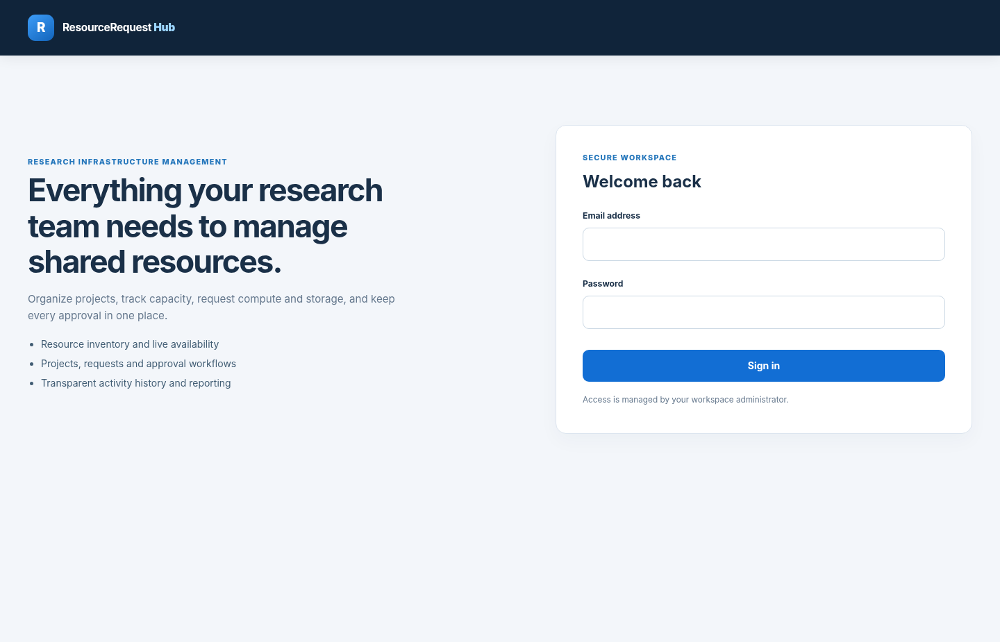

# ResourceRequest Hub

ResourceRequest Hub is a web application for managing shared computing resources within a research team. It provides a single workspace to organize projects, request CPU, GPU or storage capacity, review requests and track resource allocations.

Built with **PHP, MySQL, HTML, CSS and JavaScript**, the application runs locally using Docker Compose.



## Features

- **Dashboard:** View requests, their statuses and resource availability at a glance.
- **Resource catalog:** Browse CPU, GPU and storage pools with their available capacities.
- **Projects:** Create and organize projects, and link resource requests to them.
- **Request management:** Submit requests with a resource pool, quantity, priority and description.
- **Approval workflow:** Administrators can approve or reject requests and record decisions.
- **Capacity tracking:** Approved requests reserve capacity; released allocations make it available again.
- **Comments and history:** Discuss requests and review their activity history.
- **Analytics and CSV exports:** Explore request statistics and export accessible records.
- **User roles:** Separate permissions for regular members and administrators.
- **REST API:** Authenticated, read-only JSON endpoints for requests and resource information.

## Tech stack

| Layer | Technology |
| --- | --- |
| Backend | PHP 8.3, Apache |
| Database | MySQL 8.4, PDO |
| Frontend | HTML, CSS, JavaScript |
| Local environment | Docker, Docker Compose |
| Database administration | phpMyAdmin |
| Tests | PHP unit tests, MySQL integration tests, HTTP smoke tests |

## Getting started

### Prerequisites

- [Docker Desktop](https://www.docker.com/products/docker-desktop/) with Docker Compose
- A terminal, such as the one integrated into Visual Studio Code
- A web browser

### 1. Start the application

Clone or download this repository, open a terminal in its root folder and run:

```bash
docker compose up --build -d --wait
```

Docker starts the PHP application and MySQL database and loads the database schema automatically on first startup.

Open **http://localhost:8080/login** in your browser.

### 2. Create user accounts

Create an administrator account:

```bash
docker compose exec app php scripts/create_user.php "Demo Admin" admin@example.test admin
```

Create a regular member account:

```bash
docker compose exec app php scripts/create_user.php "Demo Member" member@example.test member
```

Enter a separate password of at least 12 characters for each account when prompted.

### 3. Try the workflow

1. Sign in with the member account.
2. Create a project and submit a request for a CPU, GPU or storage resource.
3. Sign out and sign in as the administrator.
4. Review and approve the request.
5. Check the updated resource availability in **Catalog**.
6. Release the allocation when it is no longer needed.

### 4. Stop the application

```bash
docker compose down
```

Your database is kept in a Docker volume. Do not add `-v` unless you intend to delete that volume.

## Database access

phpMyAdmin is available at **http://localhost:8081**.

The local Docker configuration uses these development-only database settings:

| Setting | Value |
| --- | --- |
| Host | `db` |
| Database | `resource_request_hub` |
| Username | `resource_app` |
| Password | `local_dev_only` |

These values are for local development. Change the credentials and configure appropriate security controls before any public deployment.

## Running tests

Run the PHP unit tests:

```bash
docker compose exec app php tests/run.php
```

On Windows, you can run the full automated verification suite from PowerShell:

```powershell
powershell -NoProfile -ExecutionPolicy Bypass -File .\verify-before-github.ps1
```

The verification script runs PHP checks, database integration tests and HTTP smoke tests. See [`docs/test-plan.md`](docs/test-plan.md) for additional manual test cases.

## Project structure

```text
app/                 Application logic and services
public/              Web entry point, frontend assets and routes
database/            MySQL schema and migrations
docker/              Apache configuration
scripts/             User and database utilities
tests/               Automated test suites
docs/                Architecture, API and testing documentation
compose.yaml         Local Docker services
Dockerfile           PHP and Apache image
```

## Notes

ResourceRequest Hub tracks reservations and allocations within its own database. It does not automatically provision physical servers, virtual machines or cloud resources.

## License

Distributed under the MIT License. See [`LICENSE`](LICENSE).
